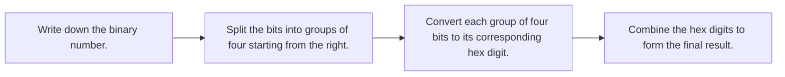

# Number Systems

## Summary

%% recon:start summary %%
- Computers store data as bits, so we use [[Binary|base 2]] (binary) and base 16 ([[Hexadecimal|hexadecimal]]) to represent numbers.
- [[Binary]] places correspond to powers of 2, while [[Hexadecimal|hexadecimal]] digits represent exactly 4 bits.
- Converting between bases involves grouping [[Binary|binary]] digits or using arithmetic for [[Decimal|decimal]] conversions.
%% recon:end %%

## Tasks

%% recon:start tasks %%
### Task 1: Why bases matter

- Computers store bits, so we use [[Binary|base 2]] or [[Hexadecimal|base 16]] to see what is in memory.

### Task 2: Binary

- Each [[Binary|binary]] place represents a power of 2, increasing from right to left as 1, 2, 4, 8, 16.
- The [[Binary|binary]] number 1101 equals 11 in [[Decimal|decimal]].

### Task 3: Hexadecimal

- [[Hexadecimal]] uses digits 0-9 and A-F, meaning one hex digit is exactly 4 [[Binary|bits]].
- The [[Hexadecimal|hexadecimal]] number 0x2F equals 46 in [[Decimal|decimal]].

### Task 4: Converting between bases

- To convert [[Binary|binary]] to [[Hexadecimal|hex]], split the bits into groups of four from the right and swap each group for a hex digit.
- 0xFF is 255 in [[Decimal|decimal]], which is the largest number one [[Byte|byte]] can hold.

**Room question:** What is 0b1010 in decimal?

> [!question]- Answer
> 10

### Task 5: Wrap-up

*Skipped.*
%% recon:end %%

## Tables and diagrams

%% recon:start tables %%
**Task 2: Binary**

| Binary | Decimal |
| --- | --- |
| 0001 | 1 |
| 0010 | 2 |
| 0100 | 4 |
| 1000 | 8 |

**Task 3: Hexadecimal**

| Hex | Decimal | Binary |
| --- | --- | --- |
| A | 10 | 1010 |
| F | 15 | 1111 |
| 10 | 16 | 10000 |

**Converting Binary to Hexadecimal** *(diagram drawn from your notes, generated)*

%% recon:end %%

## Open questions

%% recon:start questions %%
**Is there a quick way to do decimal to hex in my head?**

> [!note]- Suggested answer (generated)
> Yes. You can convert decimal to hex in your head by repeatedly dividing the number by 16 and noting the remainders. For example, 46 divided by 16 is 2 with a remainder of 14 (E), so 46 becomes 2E.
%% recon:end %%

## Source notes

%% recon:start source %%
Your notes as you wrote them: [[Number Systems (raw notes)]]
%% recon:end %%
